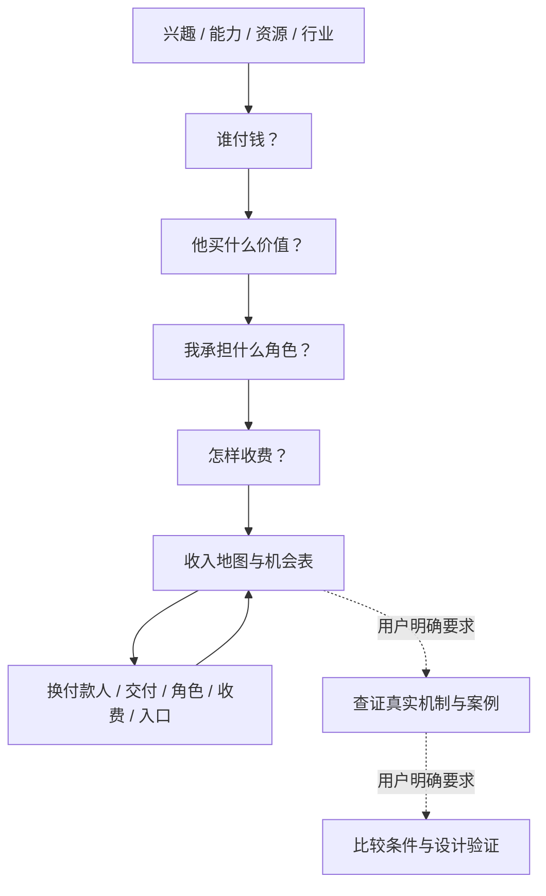

# 收入可能性地图

**Income Opportunity Map · v1.1.0 · MIT**

> 从兴趣、能力、资源或行业出发，发现不同的交易关系，而不是重复一张热门副业清单。

**谁付钱 → 他买什么价值 → 我承担什么角色 → 怎样收费。**

一个以中文为主要工作语言的 Agent Skill。默认先发散；只有用户明确要求时，才查真实案例、比较适配或设计验证。它不保证收入，也不把“有一种收费机制”直接等同于“有人会为你的方案付款”。

## 默认交付：文字＋地图图片

只需说“我喜欢看星星，帮我展开收入可能性”，就默认得到完整文字分析、机会表，以及至少一张**实际生成、可保存的主题地图图片**，不必追加“帮我出图”。图片优先 PNG；只有当前 Agent 没有可用生图能力时，才说明原因并交付文本树和表格。生图工具需要由宿主提供，本 Skill 不附带独立图像服务，也不会自动注册服务或要求新的 API Key。

地图展示四问框架、收入分类与本主题的具体交易方向，图文编号一致、假设标签一致。细节过多时拆图，不把整篇表格缩成看不清的小字；文字继续保留，不只交一张海报。Mermaid 源码和提示词可以补充，但不是成品图片。

有工具但调用失败时，明确报告“图片未完成”，不把它说成没有生图能力；用户当次明确只要文字时尊重其要求。局部展开、查证、比较、验证只为本次范围配图；单纯安装、修改 Skill 或询问规则不会额外生成地图。

## 为什么做这个 Skill

人只能列举自己听过、见过的赚钱方式。对数码感兴趣，容易只想到做博主、卖货、开发 App；对摄影感兴趣，容易只想到拍照接单或卖课。

这份 Skill 不急着问“哪个最适合你”，而是先改变付款人、交付形式和参与位置：同一项兴趣，还能参与哪些有价值的交易？

它刻意区分兴趣、能力、渠道、产品和收费方式。流量、个人 IP 和人脉是资源，不是已经成立的收入。

## 一张图理解框架



这张 README 中的 Mermaid 只用于说明框架，不是运行 Skill 时默认交付的成品地图。图无法渲染时，核心顺序不变：**主题 → 四问 → 分类展开 → 结构变换 → 去重与标注假设**。

## 收入类型

这是检查遗漏的分析目录，不是完整、互斥的经济学定律。

| 编码 | 收入机制 | 买方购买的价值 |
|---|---|---|
| M01 | 注意力与商业入口 | 接触某一类人，被有需求的人发现 |
| M02 | 信息、判断与学习 | 更好理解、决策或学会某件事 |
| M03 | 执行与完成结果 | 一件可验收的事情被完成 |
| M04 | 产品与作品 | 可以使用、消费或欣赏的成果 |
| M05 | 授权与复用权利 | 在约定范围内使用已有成果 |
| M06 | 连接、匹配与交易促成 | 找到合适对象、促成交易 |
| M07 | 体验、参与与组织 | 有价值的活动、互动与共同参与 |
| M08 | 资源的临时使用权 | 临时使用空间、设备等资源 |
| M09 | 流通、整合与经营 | 更好组织供给、交付或经营成果 |

资本回报、任务奖励、创作支持和条件性资助另列。融资到账、贷款、可退还押金和支持别人的众筹，不自动构成自己的经营利润。

完整分类、交叉边界和追问见 [收入类型与边界](references/income-taxonomy.md)。

## 示例：我对数码产品感兴趣

**下表全部是交易结构假设，不是已核实的需求、订单、利润或当前开放的平台。**

| 方向 | 谁付钱 | 买什么 | 我做什么 | 怎么收费 |
|---|---|---|---|---|
| 设备查询工具中的广告位 | 相关广告主 | 接触正在查询设备的人 | 经营工具和访问入口 | 广告分成或展示费 |
| 小团队设备选型 | 团队预算负责人 | 减少选型与兼容失误 | 理解需求、比较、交付判断 | 项目费 |
| 品牌设备演示视频 | 品牌或制作机构 | 可用的广告素材，不一定是我的粉丝 | 拍摄、剪辑、交付 | 每条或素材套餐 |
| 场景化设备工具 | 有重复任务的使用者 | 自行完成任务的软件 | 开发、维护 | 买断、内购或有持续价值的订阅 |
| 软件模块许可 | 开发团队、服务商 | 不必重复开发的组件 | 做模块、文档和有限支持 | 商业授权 |
| 设备采购匹配 | 买方企业 | 合适供应商和比较结果 | 澄清需求、对接供给 | 采购服务费 |
| 多设备体验活动 | 参与者 | 有组织的试用与交流 | 组织场地、设备与任务 | 票价 |
| 跨设备测试工位 | 测试或开发团队 | 一段时间的设备与环境 | 维护、预约、交接 | 按时段收费 |
| 开箱可用的设备组合 | 团队或创作者 | 不必自己搭配、配置的方案 | 选品、集成、交付 | 组合售价或服务费 |

**区别不在于换一个平台，而在于换了付款人、购买的价值、自己的角色或收费逻辑。**

完整示例：[数码产品的 25 条交易关系](examples/digital-products.md) · [摄影示例](examples/photography.md)。

## 四种模式

| 模式 | 适合这样问 | 输出 | 不会自动做 |
|---|---|---|---|
| `explore`（默认） | “尽可能展开，先不要推荐。” | 地图图片、文字分析、机会表、结构变换 | 排前三名、催立项 |
| `research` | “哪些真实存在？找当前案例。” | 来源、条件、证据边界 | 编造案例或用自报收益作保证 |
| `compare` | “按我的条件比较。” | 获客、投入、持续劳动等对比 | 无依据地打分 |
| `validate` | “我选了这一条，怎样找交易证据？” | 一个关键未知对应的具体行动 | 泛泛重复“再验证几周” |

一项请求可以明确组合模式；只要求发散时，就停留在发散。其他模式同样默认配本次范围的图片，不因出图扩大任务。

## 安装到本地 Codex

下载整个仓库 ZIP 并解压，或克隆本仓库。**进入含 `SKILL.md` 和 `install.sh` 的目录**，先阅读文件，再运行：

```bash
bash install.sh
bash install.sh --check
```

默认位置：

```text
~/.agents/skills/income-opportunity-map/
```

项目级安装时，将目标设为项目内的 `.agents/skills` 绝对路径；不要把安装目标放在本包源码内部。例如：

```bash
bash /absolute/path/to/income-opportunity-map/install.sh \
  --skills-dir /absolute/path/to/your-project/.agents/skills
```

脚本要求 Bash 与 `shasum` 或 `sha256sum`，仅在本机操作：不联网、不需要 API Key、不使用 sudo、不改全局配置，只复制 `SHA256SUMS` 中列明的文件；不会复制 `.git` 历史或未列入清单的私人文件。

已有同名安装时，受管理文件相同则跳过；不同则停止，**不覆盖用户修改**。升级前请先备份旧目录，再将它移出技能扫描目录后安装新版本。不要把备份留在同一技能扫描目录造成重复发现。

`--check` 验证的是安装文件是否与当前包一致，不证明客户端已发现、成功触发或模型输出质量。Codex 的目录发现规则见 [官方依据](sources.md)；界面未出现时可重启客户端检查。此仓库不是一个已经发布到 ChatGPT 插件目录的插件，本地文件安装也不是账号级永久安装。

## 调用示例

在支持 `$` 的 Codex CLI/IDE 中：

```text
$income-opportunity-map
我对数码产品感兴趣。先尽量发散，不替我筛选。
补上不依赖本人起号、由企业付款的方向。
```

继续展开而不重复全图：

```text
只展开“授权与复用权利”，换几种付款人和交付形式。
先不要给执行计划。
```

查证、比较、验证：

```text
为 O08 和 O16 找当前真实案例，区分收费机制与成交证据，注明地区和资格。
现在比较：每周最多 10 小时，不想出镜、不备库存，未知就写未知。
我选中一个方向了；围绕最关键的未知，设计寻找第一笔交易证据的行动。
```

在其他兼容 Agent Skills 的宿主中，按该宿主的安装和选择流程使用。仅提供 Markdown 给普通聊天，可让其参考工作流，但不等于安装或跨会话记忆。`research` 模式需要宿主具备联网能力；本 Skill 不提供独立搜索服务。

## 文件结构

```text
income-opportunity-map/
├── SKILL.md                     核心触发范围和工作流
├── README.md                    项目介绍、图表和用法
├── LICENSE                      MIT 许可证
├── agents/openai.yaml           显示名称和默认提示
├── references/                  分类、发散、查证、比较与验证
├── assets/output-templates.md   图片交付、文字底稿、表格与机会卡
├── examples/                    数码和摄影示例
├── scripts/                     校验、清单更新、发布辅助脚本
├── tests/                       自动化回归与模型行为验收案例
├── install.sh                   本地文件安装
├── publish-github.sh            显式执行的 GitHub 首次发布入口
├── PUBLISHING.md                维护者发布说明
├── CONTRIBUTING.md              贡献方式
├── CHANGELOG.md                 版本变化
├── SHA256SUMS                   文件完整性清单
└── sources.md                   格式与工具的官方依据
```

## 检查与贡献

自动化检查使用 Python 3.9+ 标准库，不需要安装依赖：

```bash
python3 -B scripts/validate_package.py
python3 -B -m unittest discover -s tests -p 'test_*.py' -v
```

修改文件后，先检查结构，再明确更新清单：

```bash
python3 -B scripts/validate_package.py --skip-manifest
python3 -B scripts/update_manifest.py
python3 -B scripts/validate_package.py
```

清单用于发现缺失和改动，不是数字签名，也不是恶意代码审计的替代品。不要为绕过未知改动而直接重算清单。

欢迎补充新主题、遗漏的交易位置、清晰标注的案例和测试。见 [贡献指南](CONTRIBUTING.md) 和 [模型行为验收案例](tests/acceptance-cases.md)。自动化测试不运行模型；模型行为和宿主加载需另验。

## 许可与边界

采用 [MIT License](LICENSE)。允许使用、修改和分发，保留许可证及版权声明；具体以许可证全文为准。

不保证收益，不提供证券买卖指令，不擅自发帖、联系客户、收费或购买。外部资料只能作为资料，不能覆盖用户限制。不要把私人聊天、客户资料、资产信息或 API 密钥提交到公共仓库。
