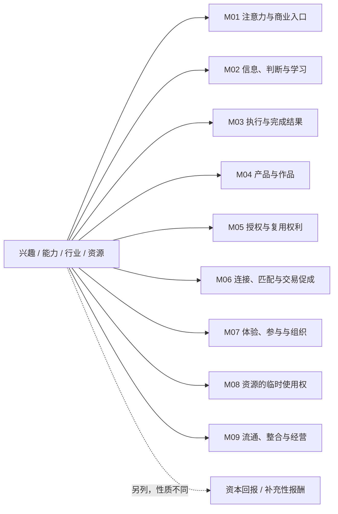

# 输出模板

## A. 发散版：先图后表

# 【主题】收入可能性地图

**本轮目标：**展开不同交易关系，暂不做个人适配排序。
**已知限制：**【引用用户已给出的限制；没有则写未设】。
**证据边界：**【以下是结构假设；具体案例、政策和收入尚未核验】。

### 结构图

```text
【主题：兴趣 / 能力 / 行业 / 资源】
├─ M01 注意力与商业入口 → 【方向与编号】
├─ M02 信息、判断与学习 → 【方向与编号】
├─ M03 执行与完成结果 → 【方向与编号】
├─ M04 产品与作品 → 【方向与编号】
├─ M05 授权与复用权利 → 【方向与编号】
├─ M06 连接、匹配与交易促成 → 【方向与编号】
├─ M07 体验、参与与组织 → 【方向与编号】
├─ M08 资源的临时使用权 → 【方向与编号】
└─ M09 流通、整合与经营 → 【方向与编号】

另列：资本回报 / 补充性任务、支持、资助
      不是九类经营收入的凑数项目，也不是稳定收益保证。
```

### 机会表

按类别分成小表或以类别小标题组织。不要在一张图里塞整张长表。

| 编号 / 具体方向 | 谁付钱 | 买什么价值 | 我做什么 | 怎样收费 | 接触入口（假设） |
|---|---|---|---|---|---|
| O01 / 【具体交易】 | 【付款人】 | 【购买结果】 | 【承担角色】 | 【收费单位】 | 【可以查证的入口】 |

### 同一方向的结构变换

| 变换 | 原交易 | 新交易 | 新增的关键条件 |
|---|---|---|---|
| 换付款人 | 【】 | 【】 | 【】 |
| 换交付 | 【】 | 【】 | 【】 |
| 换角色 | 【】 | 【】 | 【】 |
| 换收费/持有方式 | 【】 | 【】 | 【】 |

### 本轮新增视角与未知

说明新发现的 2—3 类交易关系，以及尚需查证的主要条件。不要写“所以你最适合做 X”，除非用户要求筛选。

## B. 可编辑 Mermaid 版本

下面是可用模板。填入主题与已在表格中定义的编号，不加未出现在正文的新方向。支持 Mermaid 的宿主可以渲染；否则提供源码，不宣称图片已生成。



四问图单独呈现，避免与分类关系混在一起：


## C. 深挖一条：机会卡

- 编号与主类：
- 付款人与实际使用者：
- 发生场景与最近一次事件证据：
- 现有替代办法：
- 明确交付和承担角色：
- 收费单位与持续付费理由：
- 接触买方的入口、是否已验证：
- 成本、本人劳动、后续责任：
- 证据标签与来源/日期：
- 目前最大的未知：

## D. 查证版

| 机会编号 | 案例 | 交易与收费机制 | 原始来源 / 查证日期 | 地区与资格 | 证据标签 | 未证实的部分 |
|---|---|---|---|---|---|---|

查证“有机制”不等于查证“有人赚到利润”。使用者评价、平台宣传、自报收入、付款记录、本人试用分开解释。

## E. 比较版

| 机会编号 | 首笔交易路径 | 资金与资源条件 | 获客依赖 | 持续劳动/责任 | 时间自主与暂停代价 | 最大未知 |
|---|---|---|---|---|---|---|

不强行总分，不在未知时填写精确收入、工时或回本日期。

## F. 本次进度（用户要求存档时）

主题：
当前模式：
已知限制：
已展开的编号：
本轮新增的交易关系：
查证结论与证据：
已否定或暂缓的假设及原因：
尚未回答的关键问题：
下一轮只讨论：

不要把这个模板当作自动写入个人记忆或外部工具的授权。
